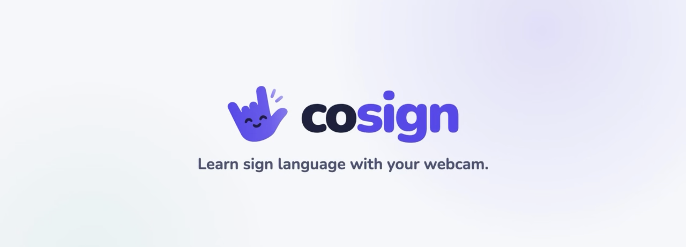

# cosign: learn ASL with your webcam

**cosign** is a gamified web app that helps family and friends of Deaf people learn American Sign Language (ASL). You watch a real Deaf signer demonstrate a sign, sign it back to your webcam, and a pretrained sign-recognition model checks whether it matched.

**Live demo:** [cosign-learning.vercel.app](https://cosign-learning.vercel.app)



## Quick start

**Prerequisites:** [uv](https://docs.astral.sh/uv/) (installs Python 3.12 if needed), Node 22.12+, the [SpacetimeDB CLI](https://spacetimedb.com/install) 2.13+ (only needed for accounts), and Chrome or Edge.

**1. Set up the accounts database (one time)**

```bash
# Install SpacetimeDB CLI
curl -sSf https://install.spacetimedb.com | sh

# Sign in
spacetime login
spacetime login show
# Send this identity to the database owner
# The owner runs: spacetime call --server maincloud calhack-r0hwe add_admin <identity>

# Once you are an admin:
cd spacetimedb && npm install
spacetime publish --server maincloud --module-path spacetimedb --yes calhack-r0hwe
```

**2. Start the recognition service** (http://127.0.0.1:8000)

```bash
cd backend
uv sync
uv run python scripts/download_model.py   # 11 MB model, checked by SHA-256
uv run uvicorn app.main:app --port 8000
```

**3. Start the web app** (http://localhost:5173)

```bash
cd frontend
npm install
npm run dev
```

Open http://localhost:5173, allow the camera, and start **First words**.

For the best results, sit 60–90 cm from the camera with your head and both hands in view, and face a light source.

## How it works

1. **In the browser**, MediaPipe Holistic tracks 543 landmarks per frame (face, both hands and body). A segmenter cuts the stream into sign attempts and sends just those coordinates to the backend.
2. **On the backend**, FastAPI checks the input, trims idle frames, and rejects attempts with no hands, no face or no movement. Then it runs the sign model.
3. **The model** is the 1st-place solution from Google's [Isolated Sign Language Recognition](https://huggingface.co/sign/kaggle-asl-signs-1st-place) Kaggle competition, and it ranks 250 signs. An attempt is accepted only when the target sign is the top guess, with at least 40% confidence and a 10-point lead over the next guess.
4. **Accounts are optional.** They are stored in SpacetimeDB and keep leaderboard XP, sessions and friendships. XP is awarded only after an accepted recognition result.

## Repository layout

```
spacetimedb/
  src/index.ts          accounts database: tables and admin-only procedures
backend/
  app/main.py           FastAPI routes
  app/recognition.py    acceptance rules: trimming, quality gates, thresholds
  app/classifier.py     TFLite model inference
  app/accounts.py       /api/account routes (app/spacetime.py is the DB client)
  app/schemas.py        API request and response formats
  scripts/              model download, data fetching, evaluation, calibration
  tests/                pytest, including real PopSign landmark data
frontend/
  src/screens/          Dashboard, LessonScreen, CompleteScreen
  src/components/       CameraView, SignDemo, FeedbackSheet, ModelGuesses, …
  src/hooks/            useCamera, useRecognizer
  src/lib/              lesson engine, progress, segmenter, API client
  src/content/          lessons.json and clips.json
  public/signs/         46 demo clips of Deaf signers
  e2e/                  browser test with a fake webcam
docs/
  architecture.svg      system diagram
```

## Testing

| Command                                             | What it covers                                                                      | Result        |
| --------------------------------------------------- | ----------------------------------------------------------------------------------- | ------------- |
| `cd backend && uv run pytest`                       | Model output, accept/reject rules, API contract, accounts and leaderboard           | 48 passed     |
| `cd frontend && npm test`                           | Lesson flow, XP rules, saved progress, segmenter, API errors                        | 42 passed     |
| `cd frontend && npm run typecheck && npm run build` | Strict TypeScript and production build                                              | OK            |
| `cd frontend && npm run e2e`                        | Full lesson in a real browser with a fake webcam, real MediaPipe and the real model | 5 of 5 passed |

The end-to-end test needs extra data tools:

```bash
cd backend
uv sync --extra validation
uv run python scripts/fetch_popsign_samples.py hello please thankyou yes no bye --per-sign 6
uv run python scripts/extract_landmarks.py data/popsign
uv run python scripts/make_fake_webcam.py
```

## Credits and licences

- **Sign videos and test data:** [PopSign ASL v1.0](https://signdata.cc.gatech.edu/view/datasets/popsign_v1_0/) by Thad Starner et al., Georgia Institute of Technology and the Deaf Professional Arts Network, [CC BY 4.0](https://creativecommons.org/licenses/by/4.0/). Clips were trimmed and re-encoded; sources are listed in `frontend/src/content/clips.json`.
- **Recognition model:** [kaggle-asl-signs-1st-place](https://huggingface.co/sign/kaggle-asl-signs-1st-place) by Hoyeol Sohn, MIT.
- **Landmarks:** [MediaPipe Holistic](https://github.com/google/mediapipe), Apache-2.0.
- **Font:** Nunito, SIL Open Font License.
